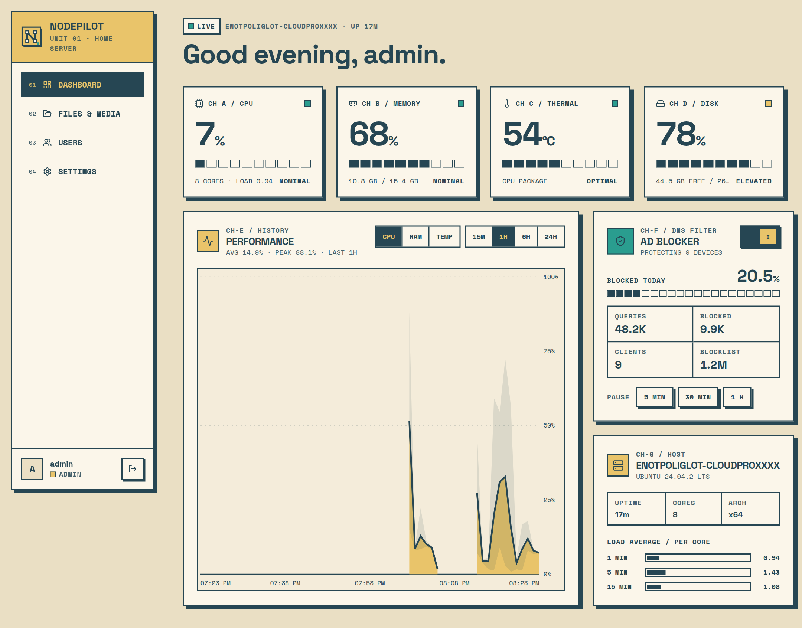
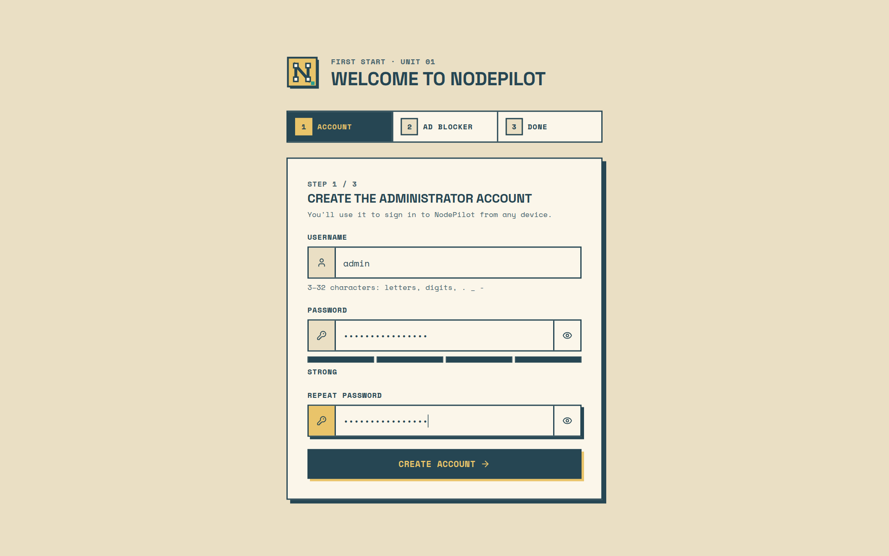
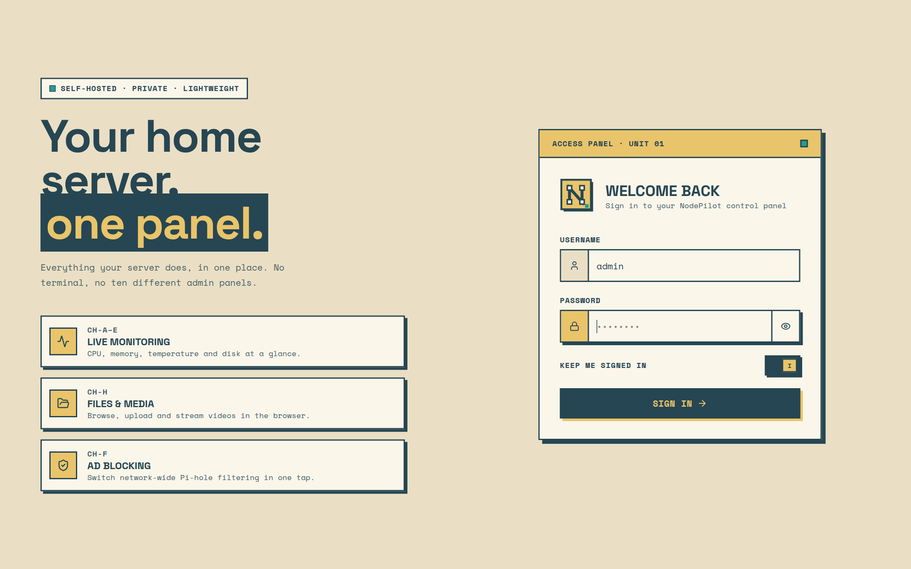
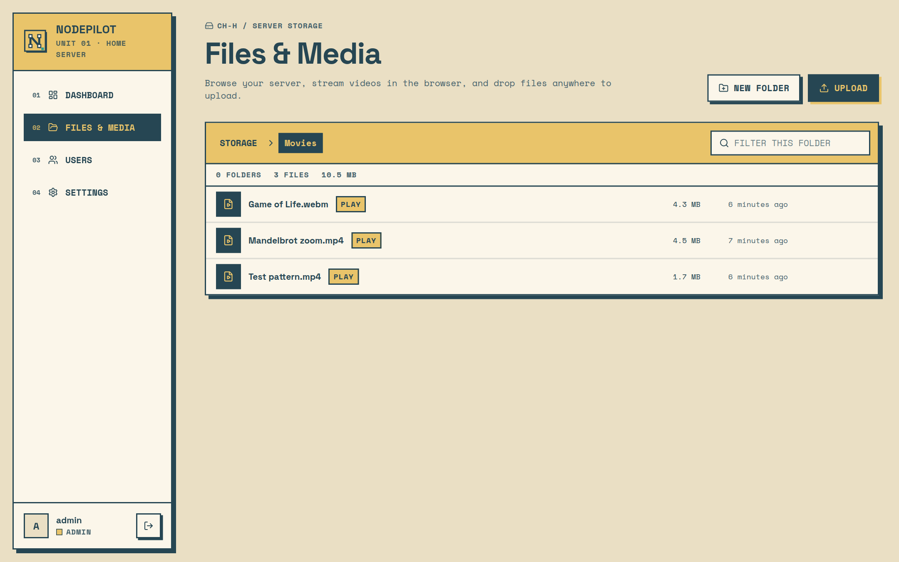
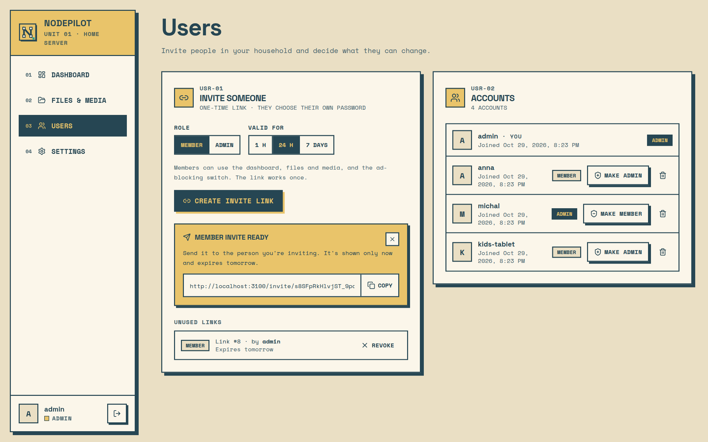
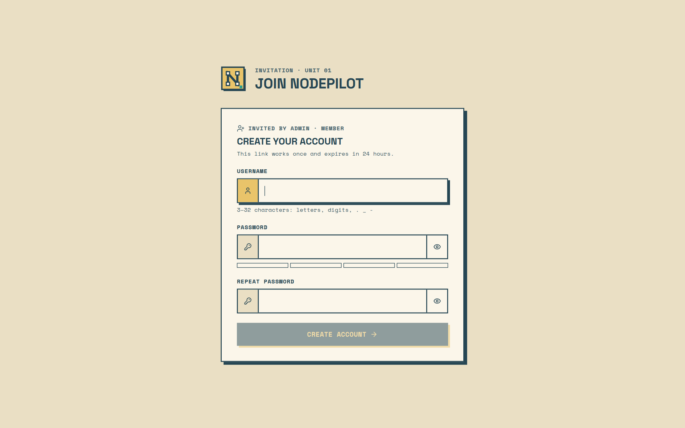
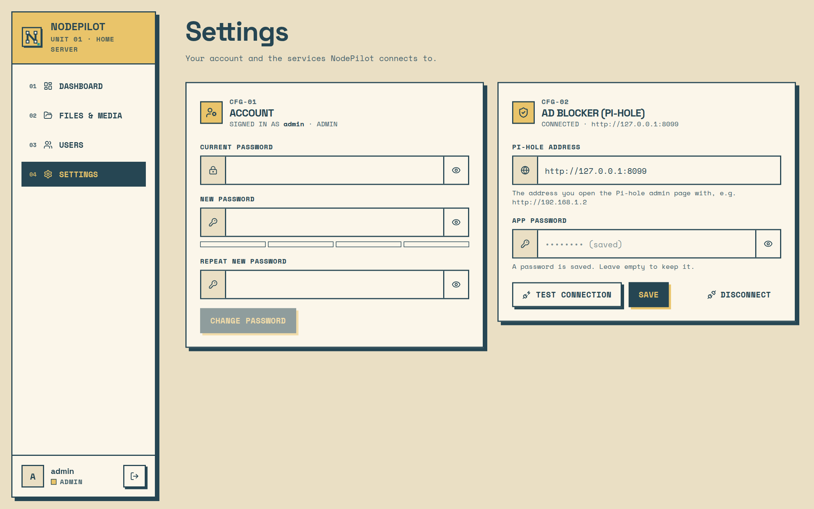
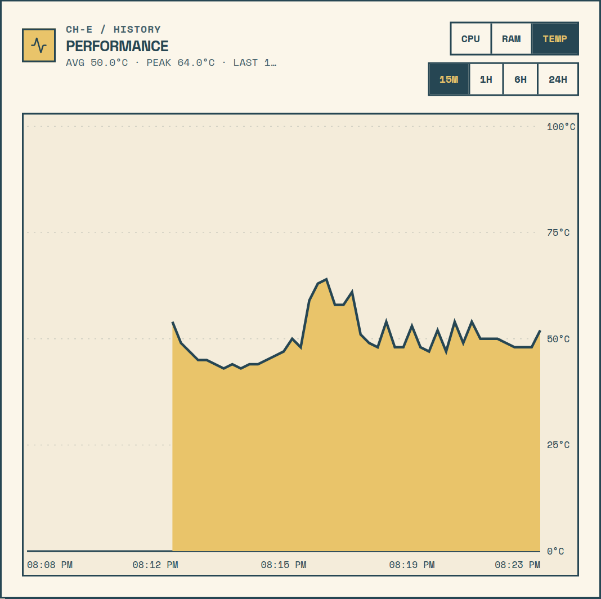
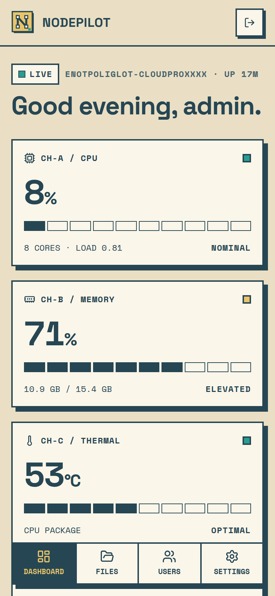
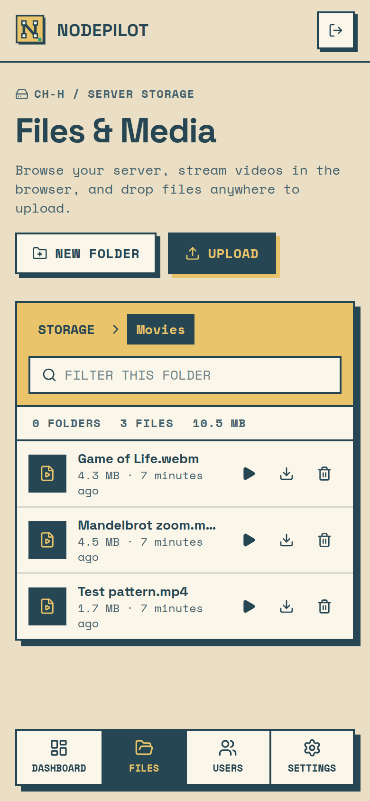

# NodePilot

NodePilot is a lightweight, unified control panel for a home server. One web app, reachable from any device in your home network, replaces the terminal and the separate admin panels for the everyday jobs:



| Feature | What it does |
|---|---|
| **Live dashboard** | CPU, memory, CPU temperature and disk usage as animated gauges, a CPU / memory / temperature history chart (15 min – 24 h), uptime, load average and host details. |
| **Files & media** | Browse a sandboxed folder on the server, upload (drag & drop), create folders, download and delete files. |
| **Video player** | Stream MP4, WebM, MOV and OGV videos (plus audio and images) right in the browser, with seeking via HTTP range requests. |
| **Ad blocking** | Pi-hole (v6) integration: see today's statistics and switch network-wide blocking on/off or pause it for 5 min – 1 h. |
| **Setup & settings** | First-start wizard creates the administrator account; Settings lets you change the password and connect/test Pi-hole. No `.env` editing needed. |
| **Users** | Invite your household with one-time links; Admin and Member roles. |
| **Sign-in** | HTTP-only session cookie, salted PBKDF2 password hash, login rate limiting. |

## Screenshots

| | |
|:-:|:-:|
|  |  |
| **First start:** create the administrator account | **Sign in** from any device |
|  |  |
| **Files & Media:** browse, upload, download | **Video player** with seeking, right in the browser |
|  |  |
| **Users:** one-time invite links and roles | **Invite page:** the new user picks a password |
|  |  |
| **Settings:** password and Pi-hole connection | **Performance:** CPU temperature over 15 minutes |

<p align="center">
  
  &nbsp;&nbsp;
  
</p>
<p align="center"><b>On a phone:</b> the same panel with a bottom tab bar.</p>

<sub>Screenshots use a demo instance: sample files, demo accounts and a stand-in Pi-hole with example statistics.</sub>

## Quick start

You need **.NET SDK 10** and **Node.js 20.9+** ([nvm](https://github.com/nvm-sh/nvm) is enough: the script switches versions itself). Then:

```bash
git clone https://github.com/skmkqw/node-pilot.git
cd node-pilot
./start.sh
```

The script checks the requirements, installs dependencies on the first run, builds the backend and starts both parts in one terminal. When it is ready it prints where to open the app:

```text
================  NodePilot is running  ================
  This computer:     http://localhost:3000
  Phone (Wi-Fi):     http://192.168.1.20:3000   (same network)
  Phone (USB cable): ...
  Stop:              Ctrl+C here, or ./stop.sh from any terminal
```

On the first visit NodePilot shows a **setup screen**: create the administrator account, optionally connect Pi-hole, done. No configuration files are needed.

| Command | When to use it |
|---|---|
| `./start.sh` | Normal start |
| `./start.sh --clean` | The page keeps reloading or looks outdated (clears the Next.js cache) |
| `./start.sh --install` | After pulling changes that added web packages |
| `./stop.sh` | Stop NodePilot from any terminal (same as Ctrl+C in the one running it) |

### Opening it on a phone

- **Same Wi-Fi:** open the *Phone (Wi-Fi)* address the script prints, e.g. `http://192.168.1.20:3000`. University, office and guest networks often block devices from reaching each other; then use the cable.
- **USB cable (any network):** enable *USB debugging* on the phone (Developer options), plug it in and accept the prompt. If the phone was connected when you ran `./start.sh`, it is set up automatically; otherwise run
  ```bash
  adb reverse tcp:3000 tcp:3000 && adb reverse tcp:5000 tcp:5000
  ```
  and open `http://localhost:3000` on the phone. Repeat after reconnecting the cable.

### Why two servers?

NodePilot is a client–server application: the **backend** (ASP.NET Core, port 5000) reads system metrics, manages files, streams video and talks to Pi-hole; the **web app** (Next.js, port 3000) is the user interface and gets all data from the backend's REST API. `./start.sh` runs both together.

### Troubleshooting

| Problem | Fix |
|---|---|
| `Port 5000/3000 is already in use` | NodePilot is already running: `./stop.sh`, then start again. If `stop.sh` says another program uses the port, close that program. |
| `.NET SDK 10 is required` | Install it from <https://dotnet.microsoft.com/download/dotnet/10.0>. |
| `Node.js 20.9 or newer is required` | `nvm install 22` |
| Page stuck on "Connecting…" or reloading in a loop | `./start.sh --clean` |
| Phone: "This site can't be reached" | Use the USB cable, or check that the phone is on the same Wi-Fi and has no VPN active. |
| Forgot the password | Stop NodePilot, delete `apps/backend/src/NodePilot.Api/data/nodepilot.db` (this also removes the metric history) and start again to get the setup screen. |

## Using NodePilot

A short tour for everyday use. Everything below works the same on a computer and on a phone.

### 1. First start: create your account

The very first time you open NodePilot you see **Welcome to NodePilot**:

1. **Create the administrator account.** Pick a username and a password (at least 8 characters; the bar below the field shows how strong it is). You'll use this account to sign in from any device.
2. **Connect your Pi-hole (optional).** If you use [Pi-hole](https://pi-hole.net/) for ad blocking, enter its address (e.g. `http://192.168.1.2`) and its *app password*, press **Test connection**, then **Save**. No Pi-hole? Press **Skip for now**.
3. Press **Open dashboard**. That's it.

> Do the setup right after installing: until an account exists, anyone on your network who opens the page could create it.

### 2. Dashboard: is my server OK?

- **Four channel cards** (CPU, Memory, Thermal, Disk) show live readings. The square lamp is **green** when everything is fine, **saffron** when a value is elevated, and **blinking red** when it needs attention; that card also turns saffron, and the headline counts the warnings.
- **Performance** shows CPU, memory or CPU temperature (**TEMP**) over the last 15 minutes up to 24 hours. Hover (or tap) the chart to see the exact value at that time.
- **Ad blocker** shows how many requests Pi-hole blocked today. Flip the **I/O switch** to turn blocking off or on, or press **5 min / 30 min / 1 h** to pause it; it switches itself back on when the countdown ends.
- **Host** shows the server name, uptime and load.

### 3. Files & Media: your files and videos

- Click a **folder** to open it; use the path bar at the top to go back.
- **Upload:** press **Upload**, or simply **drag files onto the page**. A progress panel shows each upload.
- **Watch a video:** click it (or the ▶ button). Videos play right in the browser and you can jump anywhere in them. Use the ← → arrows to go to the next one. MP4 and WebM work everywhere; some other formats depend on the browser.
- **Download** with the ↓ button, **delete** with the bin (you'll be asked to confirm), and create folders with **New folder**.

NodePilot only shows one folder on the server (by default `apps/backend/src/NodePilot.Api/data/files`, or `NODEPILOT_FILES_DIR` with Docker). It cannot reach anything outside it.

### 4. Users: invite your household (admins)

NodePilot has two roles:

| | Admin | Member |
|---|:-:|:-:|
| Dashboard, Files & Media, ad-blocking switch | ✓ | ✓ |
| Change own password | ✓ | ✓ |
| Invite and manage users | ✓ | – |
| Connect Pi-hole | ✓ | – |

To add someone:

1. Open **Users** and choose the role and how long the link stays valid (**1 h**, **24 h** or **7 days**).
2. Press **Create invite link**, then **Copy** (or **Share** on a phone) and send it to them.
3. They open the link, pick their own username and password, and are signed in.

Each link works **once**. Unused links are listed below the form and can be **revoked**. In the **Accounts** list you can make someone an admin or a member, or remove them; a removed user is signed out on every device immediately. You can't remove or demote yourself, so there is always at least one admin.

> Invite links go to the address you are using, e.g. `http://192.168.1.20:3000/invite/…`. Create them from the server's network address (not `localhost`) if they'll be opened on another device.

### 5. Settings

- **Account:** change your password.
- **Ad blocker (Pi-hole)** (admins): connect, re-test or disconnect Pi-hole. The password is stored encrypted and is never shown again; leave the field empty to keep it.

### 6. Signing out

Use the **exit icon** at the bottom of the sidebar (top right on a phone). With **Keep me signed in** checked, you stay signed in for a week on that device.

## Monorepo structure

```text
nodepilot/
├─ apps/
│  ├─ backend/                 # ASP.NET Core Web API (.NET 10)
│  │  ├─ src/NodePilot.Api             # controllers, auth, CORS, health checks
│  │  ├─ src/NodePilot.Application     # domain models, services, interfaces
│  │  ├─ src/NodePilot.Infrastructure  # EF Core + SQLite, background jobs, Pi-hole client
│  │  └─ tests/NodePilot.Api.Tests     # unit + integration tests (NUnit)
│  └─ web/                     # Next.js 16 / React 19 client (Tailwind 4, Motion)
├─ documents/                  # API reference, metrics notes, mockups, Postman
├─ start.sh                   # one-command local start (see Quick start)
├─ stop.sh                    # stops it from any terminal
├─ compose.yaml
└─ .env.example
```

## Tech stack

- **Backend:** ASP.NET Core (.NET 10), EF Core 10 + SQLite, ErrorOr, FluentValidation, cookie authentication, rate limiting
- **Frontend:** Next.js 16 (App Router), React 19, TypeScript, Tailwind CSS 4, Motion, Lucide icons
- **Deployment:** Docker Compose
- **Architecture:** client–server (REST, JSON), layered backend (Api → Application ← Infrastructure)

## Requirements

- .NET SDK 10.0
- Node.js **20.9+** (required by Next.js 16)
- Docker Engine with Compose (optional)
- Linux host (system metrics are read from `/proc` and `/sys`)

## Configuration

**No configuration is needed.** On the first start, NodePilot opens a setup screen:

1. Create the administrator account (the password is stored as a salted PBKDF2 hash).
2. Optionally connect Pi-hole (address and app password; the password is stored encrypted).

Both can be changed later in **Settings**.

Optional environment variables (see `.env.example`):

| Variable | Purpose | Default |
|---|---|---|
| `NODEPILOT_FILES_DIR` | Host folder shown in the file manager (Docker Compose) | `./data/files` |
| `BACKEND_PORT` / `WEB_PORT` | Published ports | `5000` / `3000` |
| `NODE_PILOT_DB_CONNECTION_STRING` | Custom SQLite location | `Data Source=data/nodepilot.db` |
| `NEXT_PUBLIC_API_URL` | Backend URL for the browser, if not `<host>:5000`; `/` behind a reverse proxy | empty |
| `ReverseProxy__Enabled` | Trust `X-Forwarded-*` headers from `ReverseProxy:KnownProxies` ([Behind nginx](#behind-nginx-https-one-address)) | `false` |
| `PiHole__BaseUrl` / `PiHole__Password` | Pre-configure Pi-hole for automated deployments (settings saved in the app take precedence) | empty |

Advanced settings live in `apps/backend/src/NodePilot.Api/appsettings.json`: monitoring intervals and retention, `FileManager:RootPath` / `MaxUploadMegabytes`, CORS, and `Auth:SessionLifetimeHours` / `LoginAttemptsPerMinute`.

The `data/` folder next to the backend holds the database and the encryption keys (`data/keys`). Back up both together.

## Running with Docker Compose

For a permanent installation on the home server:

```bash
cp .env.example .env    # optional: set NODEPILOT_FILES_DIR to the folder you want to share
docker compose up --build -d
```

- Web: <http://localhost:3000> (or `http://<server-ip>:3000` from a phone)
- Backend: <http://localhost:5000>, health checks at `/health`, `/health/ready` and `/health/live`

Both containers restart automatically. The database and encryption keys are kept in the `nodepilot-data` volume, and `NODEPILOT_FILES_DIR` is mounted as the file manager root.

### Running the parts separately

Useful when working on only one side:

```bash
# backend
cd apps/backend/src/NodePilot.Api
dotnet run

# web app (second terminal)
cd apps/web
npm install
npm run dev
```

## Behind nginx (HTTPS, one address)

By default the browser talks to two ports (`3000` and `5000`) over plain HTTP. With nginx on the host in front of both, the panel is reachable at one HTTPS address, e.g. `https://nodepilot.home`: `/api/` and `/health` go to the backend, everything else goes to the web app.

```bash
sudo apt install nginx                       # optionally also mkcert, for a certificate without browser warnings
sudo deploy/nginx/make-cert.sh               # writes /etc/nginx/ssl/nodepilot.{crt,key}
sudo cp deploy/nginx/nodepilot.conf /etc/nginx/sites-available/nodepilot
sudo ln -s /etc/nginx/sites-available/nodepilot /etc/nginx/sites-enabled/
sudo nginx -t && sudo systemctl reload nginx
echo "<server-ip> nodepilot.home" | sudo tee -a /etc/hosts   # on each client, or add it to the router's DNS
```

Then start NodePilot in proxy mode:

```bash
# backend: trust X-Forwarded-For / X-Forwarded-Proto from nginx (127.0.0.1)
cd apps/backend/src/NodePilot.Api
ReverseProxy__Enabled=true dotnet run

# web app: call the API on the page's own address (baked in at build time)
cd apps/web
NEXT_PUBLIC_API_URL=/ npm run build && npm start
```

- **Why `ReverseProxy:Enabled`?** Every request now comes from nginx (`127.0.0.1`) over HTTP. Without it, all devices share one login rate limit, and the session cookie isn't marked `Secure`. The headers are only trusted from `ReverseProxy:KnownProxies` (default `127.0.0.1`, `::1`), so a client can't fake its IP. If the backend runs in Docker, connections come from the Docker bridge instead. Add e.g. `ReverseProxy__KnownNetworks__0=172.16.0.0/12`.
- **Close the direct ports** (`3000`, `5000`) in the firewall, or bind them to `127.0.0.1`, so everyone goes through nginx.
- **Uploads:** `client_max_body_size` in `nodepilot.conf` must be at least `FileManager:MaxUploadMegabytes`.

## Tests

```bash
cd apps/backend
dotnet test
```

The suite has unit tests (path traversal protection, symlink escapes, Linux parsers, CORS policy, Pi-hole client against a fake API, UTC bucketing, invite links) and integration tests that host the real API in memory (authentication, file upload / range streaming / delete, invite flow, admin/member access control).

```bash
cd apps/web
npm run lint
npm run build
```

## Security notes

- All `/api/*` endpoints require a signed-in user; only the `/health` endpoints, sign-in/setup and the invite page's own endpoints are public. User management and Pi-hole settings require the Admin role.
- Invite links carry a 256-bit random token; only its SHA-256 hash is stored, each link works once and expires after at most 7 days.
- Every request re-checks that the account still exists, so removing a user ends their sessions at once.
- Sessions use an HTTP-only, `SameSite=Lax` cookie; login is limited to 5 attempts per minute per IP.
- The file manager is restricted to `FileManager:RootPath`. Paths are normalised and every symlink along a path is resolved, so `..` sequences and links pointing outside the root are rejected (403).
- NodePilot does not execute shell commands.
- For HTTPS on one address, see [Behind nginx](#behind-nginx-https-one-address). For access from outside the home network, use a VPN.

## Documentation

- [Feature documentation](documents/features/README.md): one document per module (user and developer perspective)
- [API reference](documents/api.md)
- [System metrics collection](documents/system-metrics.md)
- [UI mockups](documents/mockups)
