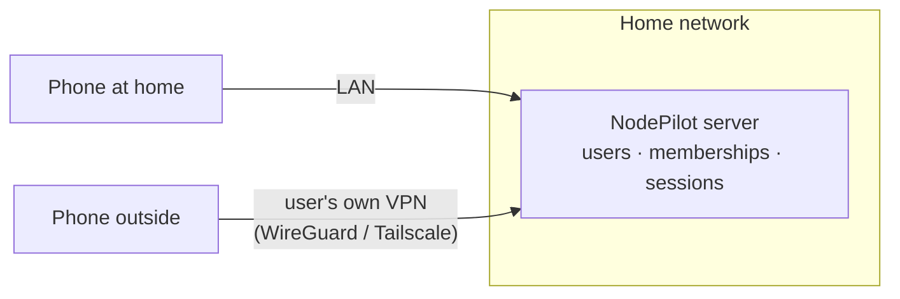
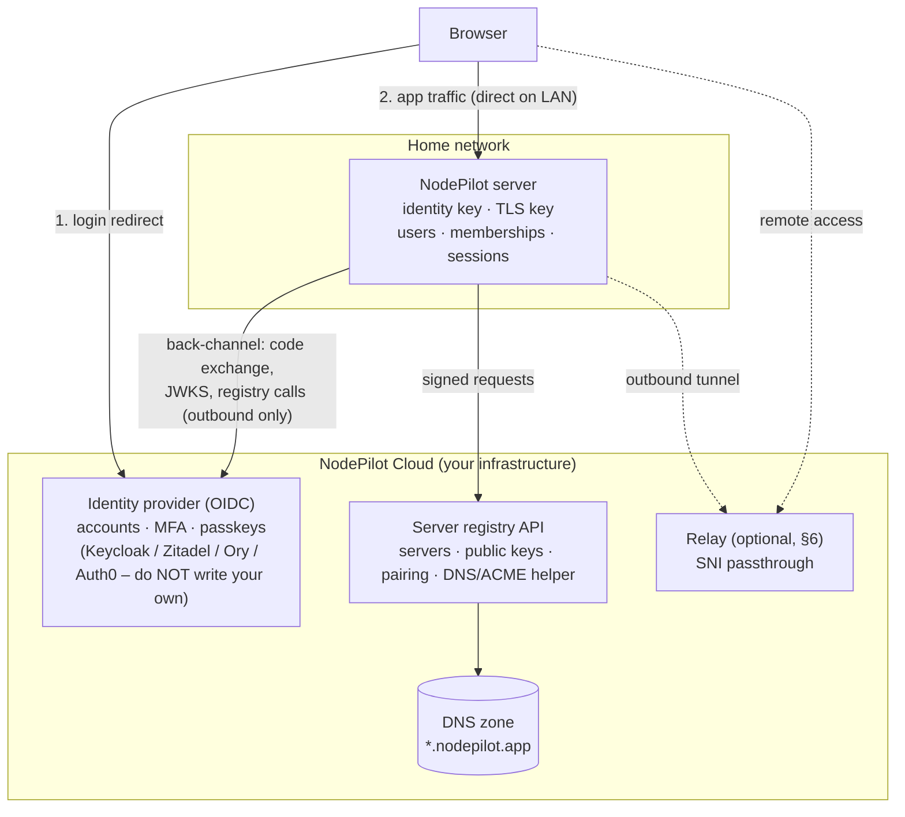
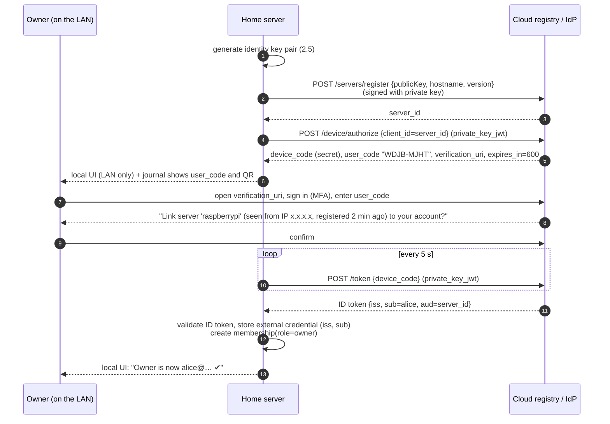
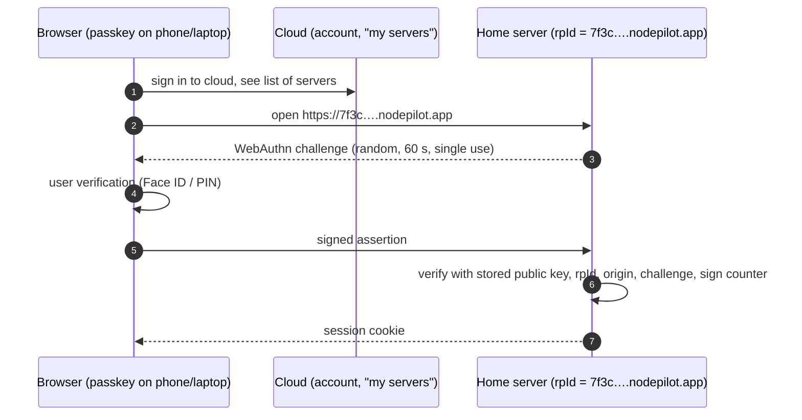

# Multi-user authentication for a distributed NodePilot

Status: proposal / analysis · 2026-11-04 (updated after merging local users, roles and invite links from `main`)

## 1. The problem

Today NodePilot has **local accounts per installation**, stored in SQLite (`users` table):

- The first administrator is created in a **first-start setup wizard**, with no credentials in `.env` any more.
- Further people join through **one-time invite links** (256-bit token, only its SHA-256 hash stored, 1 h–7 days, single use).
- There are two roles, **Admin** and **Member**. An `Admin` authorization policy protects users, invitations and service settings.
- Passwords are hashed with ASP.NET Core Identity's PBKDF2 (format v3).
- After login, the server issues an encrypted, self-contained cookie (`nodepilot.session`). Its Data Protection keys are persisted in `data/keys`.
- On every request the cookie handler re-loads the account, so a removed user is signed out at once and a role change applies immediately.

That works for "my own server in my own flat, shared with my family". It is essentially Solution A below, partly built.

Once NodePilot is distributed, there will be thousands of installations, each with an owner and maybe a few family members. Your question actually contains **three separate problems**. It helps to keep them apart, because they have different solutions:

| # | Problem | Question it answers |
|---|---|---|
| **P1. Identity** | Who is this person? | "This is Alice, she proved it with a password and second factor or a passkey." |
| **P2. Authorization** | Is this person allowed on *this* server, and with what rights? | "Alice is the owner of server `7f3c…`; Bob may only view files." |
| **P3. Reachability** | How does the browser reach the right machine? | "Alice's phone, on mobile data, connects to her Raspberry Pi behind her home router." |

Your idea is a cloud auth service plus some auth logic left on the server. That is the right direction, and it is roughly what Plex, Home Assistant Cloud, Synology QuickConnect and UniFi do. The key design decision follows from the table:

> **The cloud may answer P1 (identity) and help with P3 (reachability), but the home server must remain the final authority for P2 (authorization).**

If the cloud alone decides who gets into which server, then **one bug or one breach in the cloud gives access to every home server at once**. That is the exact failure you want to avoid. If each server keeps its own list of allowed people and checks it on every login, a cloud bug can at worst affect authentication, and it still cannot add a stranger to your server.

### What we are protecting against

| Threat | Example |
|---|---|
| T1. Token for server A used on server B | Alice is a member of her own server and of a friend's. A token issued for the friend's server is replayed against hers. |
| T2. Claiming someone else's server | An attacker guesses or phishes the pairing code of a freshly installed server and becomes its owner. |
| T3. Server impersonation | An attacker registers a fake server under Alice's server ID, or hijacks its domain, and collects her credentials or files. |
| T4. Cloud compromise | The cloud database leaks, or an insider or bug mints tokens. |
| T5. Relay eavesdropping | Traffic forwarded through the cloud is readable by the cloud. |
| T6. Revocation gaps | A stolen phone keeps access because sessions are self-contained. Partly true today: removing a user revokes their sessions at once, but logout and a password change don't revoke anything (see TASKS.md #8). |
| T7. Classic web issues | CSRF, open redirects in the login flow, session fixation, credential stuffing. |
| T8. Cloud outage | The cloud is down and nobody can get into their own server, even at home. |

---

## 2. Building blocks used by all solutions

These are needed whichever option you pick, and they are also the first steps you can take in the current codebase.

### 2.1 Local user and membership model

**What exists today** (migrations `AddAccountsAndSettings`, `AddRolesAndInvitations`):

```text
users        (id, username [unique, NOCASE], password_hash [Identity v3], role [Admin|Member],
              created_at_utc, password_changed_at_utc)
invitations  (id, token_hash [unique], role, created_by_user_id → users ON DELETE CASCADE,
              created_at_utc, expires_at_utc, accepted_at_utc)
app_settings (key, value, updated_at_utc)       ← Pi-hole URL + Data Protection-encrypted password
```

**Target model.** Evolve the tables above towards this, instead of starting over:

```text
users        (id, username, display_name, created_at, disabled_at)
credentials  (id, user_id, type[password|passkey|external], data, created_at, last_used_at)
               - password:  PHC string (today's users.password_hash moves here)
               - passkey:   credential id, public key, sign counter, transports
               - external:  issuer + subject   ← link to a cloud identity (Option B)
memberships  (user_id, role[owner|admin|member|viewer], granted_by, granted_at)
sessions     (id_hash, user_id, created_at, last_seen_at, expires_at, ip, user_agent, revoked_at)
invitations  (as today, plus accepted_by_user_id)
audit_log    (at, user_id, action, details)
```

- **Separate credentials from users.** Today the password hash is a column on `users`. A user with only a passkey or only a cloud identity needs `credentials` as its own table.
- **Roles:** today's `Admin`/`Member` map to `admin`/`member`. An explicit `owner` (the one who can't be removed by other admins, and who does pairing) and a read-only `viewer` are the missing ones. Today "you can't remove or demote yourself" is the only guarantee that an admin remains.
- **Server-side sessions** replace the self-contained cookie. The cookie holds only a random 256-bit ID, and the DB stores just its SHA-256 hash. Deleting a row logs that device out immediately (fixes T6). In ASP.NET Core this is a custom `ITicketStore` on the cookie handler, or a small custom scheme.
- The cookie should be `__Host-nodepilot`: `Secure`, `HttpOnly`, `SameSite=Lax`, `Path=/`, no `Domain`. The `__Host-` prefix stops sibling subdomains from setting or overwriting it, which matters once servers share a parent domain (see 2.4).
  Until then, the cheap intermediate step is a security stamp in the cookie that `ValidateAccountAsync` (which already runs per request) compares with the database. That gives "password change / log out all devices revokes everything" without a sessions table (TASKS.md #8).
- **Roles become authorization policies** on controllers. One exists today: `Admin` on `UsersController`, `InvitationsController` and `SettingsController`. Everything else is open to any signed-in user. Next: `[Authorize(Policy = "CanModifyFiles")]` on upload and delete, `"CanControlAdBlock"` on `POST /api/adblock/blocking`, and read endpoints for every member, which is what a `viewer` role needs.
- Identify external identities by **`(issuer, subject)`, never by email.** Emails change and get reused by new accounts at some providers. Matching by email is a classic account takeover bug.

### 2.2 First-run setup: add a setup code

**Today:** while the `users` table is empty, `POST /api/auth/setup` creates the administrator for **whoever calls it first**. It is rate limited and race-safe (a semaphore plus a re-check), but it is not tied to the machine. Anyone on the LAN, or on the internet if the port is exposed, who opens the page before the owner does becomes the admin. The README only says "do the setup right after installing". This is T2 in a local form.

**Proposal:** keep the existing wizard, and add to it. On first start, while there are no users, the backend:

1. generates a random **setup code** (e.g. 10 base32 characters, ~50 bits) and prints it to the service log / journal (`journalctl -u nodepilot-backend`, `docker compose logs backend`);
2. accepts `POST /api/auth/setup` **only from loopback or private network addresses** (the logic in `OriginPolicy` already exists) and only while no owner exists;
3. requires the setup code plus the new owner's credentials, then deletes the code. The wizard gets one more field.

Why this matters: proving you can read the server's local log is proof of physical or admin control of the machine. This "proof of possession of the box" pattern is reused for cloud pairing below.

There should also be a **break-glass CLI**, e.g. `NodePilot.Api reset-owner`, run on the machine itself. It resets the owner if all credentials are lost. Anyone with a shell on the box owns it anyway, so this doesn't weaken security. Today the documented recovery is deleting `nodepilot.db`, which also throws away metric history, other accounts and settings.

### 2.3 One origin per server

Today the web app (`:3000`) and API (`:5000`) are different origins, glued together with CORS and `credentials: include`. Login redirects, cookies and passkeys are much simpler and safer when both live on **one origin**. Serve the API under `/api` of the web origin, using Next.js `rewrites` or a small reverse proxy, and drop `AllowPrivateNetworkOrigins` for credentialed requests.

### 2.4 Per-server domain and a real TLS certificate (needed for B and C)

Browsers only give full security features (Secure cookies, WebAuthn/passkeys, service workers) to **HTTPS origins with a domain name**. A LAN IP like `http://192.168.1.10:3000` never qualifies. The standard solution, used by Plex (`plex.direct`) and others:

- Each server gets a name such as `7f3c9a2e.nodepilot.app`. The label is random and derived from the server ID, not the owner's name, so it leaks nothing.
- The cloud DNS publishes an `A` record pointing to the server's **LAN IP**, which the server reports itself. Phones at home then connect directly with no cloud in the data path.
- The server gets a **Let's Encrypt certificate via the DNS-01 challenge**:
  - the server generates its own TLS key and asks the cloud to create the `_acme-challenge` TXT record;
  - the cloud only lets a server set records **under its own name**, authenticated with the server's identity key (2.5).
  - **The certificate's private key never leaves the home server.**
- Caveat: some routers block DNS answers that point to private IPs ("DNS rebinding protection"). Document it, and fall back to the relay or to the plain LAN IP plus local login.

### 2.5 Server identity key

On first start the server generates an **Ed25519 (or P-256) key pair**:
- stored in `data/identity/` with mode `0600`;
- the public key is registered with the cloud during pairing.

From then on the server proves who it is to the cloud by signing requests: OAuth `private_key_jwt` client authentication (RFC 7523) or mTLS. **Knowing a server ID is never enough to act as that server.** This is the defence against T3.

---

## 3. Solution A: local-only accounts (no cloud)

**Idea.** Each server is its own island. It manages its own users (2.1) with passwords and/or passkeys. Remote access is the user's job, via a VPN such as WireGuard, Tailscale or Headscale.



**How it works** (✔ = already implemented)
- ✔ Owner created by first-run setup (2.2). Missing: the setup code.
- ✔ The owner invites family members from the UI. An invite is a one-time link (`/invite/<token>`) with a random 256-bit token, stored hashed, valid 1 h–7 days, single use. The invitee opens it and sets a password. Missing: registering a passkey instead.
- ✔ Login with a password, PBKDF2 (Identity v3), rate limited per IP. Missing: a per-account limit, optional TOTP, passkeys.

**Pros**
- Smallest attack surface; there is nothing central to breach (T4 doesn't exist).
- Works offline (T8).
- No running costs, no GDPR obligations for you as a vendor.
- Mostly built already.

**Cons**
- Each server has separate accounts, with no single login across several servers.
- Remote access is left to the user.
- Passkeys need a domain and HTTPS (2.4). Without a cloud helper, the user has to set that up themselves.
- Account recovery is local only (break-glass CLI).

**Verdict:** finish this **first, regardless of the final choice**. Options B and C extend it; they don't replace it.

---

## 4. Solution B: cloud identity + local authorization (your idea, made safe)

**Idea.** A central **NodePilot Cloud** offers accounts with one login for all your servers. It also keeps a registry of servers and helps with domains and certificates. Each home server is an **OpenID Connect relying party** of that cloud: it trusts the cloud to say *who* someone is, then checks its *own* membership table to decide whether that person gets in.

### 4.1 Components



**Where to run the cloud.** It is a small, ordinary cloud app: a container platform (Azure Container Apps, AWS ECS/Fargate, Fly.io, Hetzner + k3s), Postgres for the registry, and a DNS provider with an API (Cloudflare, Route 53). **Don't write the identity provider yourself.** Password storage, MFA, passkeys, brute-force protection, account recovery and email verification are exactly where home-grown code goes wrong. Use:
- **Keycloak** or **Zitadel** (self-hosted, open source, cheaper at scale), or
- **Auth0**, **Ory Network** or **Microsoft Entra External ID** (managed).

What you write yourself is the **Server registry** (an ASP.NET Core service, so the same stack) and, later, the relay.

### 4.2 Pairing a server to an account (claim flow)

Pairing is the most security-critical step: it decides which account owns which machine (T2). It is built on the **OAuth 2.0 Device Authorization Grant (RFC 8628)**, the same flow a smart TV uses to show "go to example.com/activate and enter ABCD-EFGH".



Crucial details:
- **The user code is only shown locally**: in the LAN-only setup page and in the journal. Whoever enters it proves they can see the box (2.2). Use ≥ 8 characters from an unambiguous alphabet (≈ 40 bits), a 10-minute expiry, single use, and a limit of e.g. 5 wrong attempts per account per hour **and** per device code. After that the code is burned.
- **The `device_code` is a secret that only the server knows.** The browser never sees it. The server polls with it while authenticating with its private key, so a stolen user code alone gives nothing.
- **The confirmation screen shows server details** (hostname, approximate source IP or location, registration time). This defends against reverse phishing, where an attacker sends Alice *their* user code so that she unknowingly links *their* server to *her* account.
- **The server, not the cloud, records the owner.** The cloud also stores "server_id → owner account" for convenience ("My servers" list, DNS), but that row is not what grants access.
- **Re-pairing a claimed server requires local action** (break-glass CLI or the owner's own session). The cloud can never move ownership on its own. Even a cloud admin cannot hand your server to someone else (T4).

### 4.3 Logging in to a server (every day)

The **home server's backend is the OIDC client**: a confidential client using Authorization Code + PKCE, a "backend-for-frontend". The browser never holds OAuth tokens, only the server's own session cookie.

```mermaid
sequenceDiagram
  autonumber
  participant B as Browser
  participant S as Home server (7f3c….nodepilot.app)
  participant IdP as Cloud IdP
  B->>S: GET /dashboard (no session)
  S-->>B: 302 to IdP /authorize?client_id=server_id&redirect_uri=https://7f3c….nodepilot.app/auth/callback<br/>&code_challenge=…(S256)&state=…&nonce=…&scope=openid
  B->>IdP: sign in (password+MFA / passkey; already signed in = no prompt)
  IdP-->>B: 302 to redirect_uri?code=…&state=…
  B->>S: GET /auth/callback?code&state
  S->>IdP: POST /token {code, code_verifier} + private_key_jwt
  IdP-->>S: ID token
  S->>S: validate token (list below)
  S->>S: look up membership by (iss, sub)
  alt member
    S-->>B: Set-Cookie __Host-nodepilot=<random>; 302 /dashboard
  else not a member
    S-->>B: 403 "You are signed in as bob@…, but you have no access to this server. Ask the owner for an invite."
  end
```

ID token validation on the server (all mandatory; in ASP.NET Core `AddOpenIdConnect` does most of it, but check the config):

1. Signature checked against the IdP's JWKS (cached, refreshed on unknown `kid`, **pinned algorithm list**, never `none`/`HS*`).
2. `iss` is exactly the configured issuer.
3. **`aud` contains exactly this server's `client_id`** (and `azp` too, if present). This defeats T1: a token minted for server A is useless at server B.
4. `exp`/`iat` with ≤ 2 min clock skew; `nonce` matches the one stored in the encrypted state; `state` matches (CSRF protection for the login itself, T7).
5. The **redirect URI is registered exactly** per server at pairing time: no wildcards, no prefix matching, no open redirect in `returnUrl` (only allow relative paths).
6. Then the **local membership check** by `(iss, sub)`. The IdP's answer alone never grants access.

After this, NodePilot uses its own server-side session (2.1). Normal API calls never touch the cloud, which keeps the dashboard fast and working through short cloud outages.

### 4.4 Inviting other people

1. The owner clicks *Create invite link* in the local UI and picks a role. The **server** creates the invite exactly as it does today (random token, hashed in the `invitations` table, role, 1 h–7 days expiry, single use).
2. The link `https://7f3c….nodepilot.app/invite/<token>` is shared by any channel. The cloud may send the email, but it never sees or decides the role.
3. The invitee opens it and logs in via the cloud (4.3). The callback sees the pending invite in the encrypted state and creates a membership for the returned `(iss, sub)`.
4. Bind to the **token, not to the email address** the invite was sent to. If you want, also require `email_verified=true` and a matching email as an additional check, never as the only one.
5. Removing someone: delete the membership and all their sessions in one transaction. It takes effect immediately, as it already does today through the per-request account check.

### 4.5 Revocation and lifetimes

- Local session: idle timeout (e.g. 7 days) **and** absolute lifetime (e.g. 30 days). The dashboard's polling should not extend the session forever; only real user activity should. That fixes a limitation already documented in `authentication.md`.
- Account disabled or MFA reset in the cloud: the cloud sends an **OIDC Back-Channel Logout** token (or an event over the tunnel, §6) to every server where that `sub` has sessions, and the server deletes them. Since that delivery can fail, the server also forces a fresh IdP login when the absolute lifetime ends.
- "Log out all devices" in the local UI deletes all session rows for that user.

### 4.6 Cloud outage and offline mode (T8)

- Existing sessions keep working; they don't depend on the cloud.
- New logins need the IdP. So **keep at least one local credential for the owner** (a passkey or password from Solution A) as a fallback that works on the LAN. It can be restricted to private network source addresses.
- The JWKS is cached, but a cached JWKS alone isn't enough to log in. The token still has to come from the IdP.

### 4.7 Remaining risk of Solution B

A fully compromised IdP can mint a valid ID token with **Alice's** `sub` for **Alice's** server, and the local membership check would accept it. The local membership check stops the IdP from *adding strangers*, but not from *impersonating existing members*. Mitigations, from cheap to strong:
- Strong operations for the IdP (managed provider, MFA for admins, HSM-backed signing keys, audit).
- Notify the owner of logins from new devices (from the server, not the cloud).
- **Step-up with a locally registered passkey** for dangerous actions (delete, settings, invites), or for every login. That is Solution C.

---

## 5. Solution C: cloud as a broker only, passkeys verified by the server

**Idea.** The cloud provides accounts and a *list* of your servers, domains and certificates, the relay, and invite email delivery. **Authentication into a server happens directly between the browser and the server with WebAuthn passkeys.** The server stores the public keys itself and checks the signatures itself. The cloud never produces anything the server would accept as proof of identity.



How it works:
- Pairing as in 4.2. Instead of (or besides) linking a cloud `sub`, the owner **registers a passkey on the server itself** during first-run setup, proven by the setup code (2.2).
- Invites as in 4.4, but the invitee registers a passkey on the server instead of linking a cloud login.
- **The passkey is bound by the browser to the server's domain** (the `rpId`). A passkey for `7f3c….nodepilot.app` cannot be used on `9a1b….nodepilot.app` or on a phishing site. The browser enforces this, which makes it strong protection against T1 and T3.
- Library: `Fido2NetLib` (fido2-net-lib) on the backend, `@simplewebauthn/browser` on the frontend.

**Pros**
- A full cloud breach **cannot** produce access to any server (T4 solved, not just reduced).
- Phishing-resistant login.
- The cloud is optional for logging in at home.

**Cons**
- Needs the per-server domain and HTTPS (2.4), because WebAuthn doesn't work on bare LAN IPs (except `localhost`).
- Each server keeps its own passkeys, so there's no single login across servers. Platform passkey sync (iCloud Keychain, Google Password Manager) makes this mostly invisible to users.
- Recovery when all passkeys are lost: the break-glass CLI on the box, or a second passkey registered in advance.

---

## 6. Reachability from outside the home (P3)

Independent of A/B/C, users will want access from their phone on mobile data. Home servers are behind NAT and often behind carrier-grade NAT (no public IPv4), so port forwarding often isn't possible. Options:

| Option | How | Security notes | Cost |
|---|---|---|---|
| **R1. User's own VPN** (WireGuard, Tailscale, Headscale) | Phone joins the home network virtually | Best isolation; nothing exposed | None for you |
| **R2. Relay with TLS passthrough** | Server keeps an **outbound** connection to `relay.nodepilot.app`. The relay accepts browser TLS for `*.nodepilot.app`, reads only the **SNI** (the hostname in the TLS ClientHello), and forwards the still-encrypted bytes through that server's tunnel | **End-to-end TLS**: the certificate key lives only on the home server, so the relay can't read cookies or files (T5). The tunnel itself is authenticated with the server identity key (2.5), so a fake server can't attach to Alice's hostname (T3). | **Bandwidth**: streaming video through the relay is expensive. Limit rate/quota and prefer direct paths |
| **R3. P2P mesh** (WireGuard with a coordination server, NAT traversal, relay only as a fallback) | Like Tailscale; you'd integrate rather than build | Strong, but complex to build | Low bandwidth cost |
| ✗ **TLS-terminating relay / Cloudflare Tunnel by default** | The cloud decrypts and re-encrypts | The cloud sees all traffic and sessions, which conflicts with T4/T5 | — |

Recommended: start with **R1** (document Tailscale) and LAN access via the per-server domain. Add **R2** as the paid "remote access" feature. On the home network, DNS already resolves the per-server domain to the LAN IP, so local traffic never goes through the relay.

Extra checks on the server once it is reachable from outside:
- Validate the `Host` header against its own hostname(s): `AllowedHosts` in `appsettings.json` is currently `*`. This protects against DNS rebinding.
- Rate-limit login and invite endpoints **per account** as well as per IP (behind the relay all IPs look the same; see TASKS.md #2).
- Send security headers: HSTS (only once the domain setup is stable), CSP, `X-Frame-Options: DENY`.

---

## 7. Comparison

| | A. Local only | B. Cloud identity + local authorization | C. Cloud broker + local passkeys |
|---|---|---|---|
| Single login across servers | ✗ | ✔ | ~ (passkey sync) |
| Cloud breach → access to servers | impossible | can impersonate *existing* members | impossible |
| Stranger added via cloud bug | impossible | impossible (local membership) | impossible |
| Works with no internet | ✔ | existing sessions + local fallback | ✔ (on LAN with domain) |
| Phishing resistance | with passkeys | depends on IdP (passkeys at IdP) | ✔ |
| Effort | low | high (IdP setup, registry, pairing, DNS) | high (registry, DNS) + medium (WebAuthn) |
| Vendor running costs | none | IdP + registry (+ relay) | registry (+ relay) |

---

## 8. Recommendation and roadmap

Your instinct is right, with one correction: the cloud should **establish identity and help with connectivity**, but **access decisions stay on the home server**. Concretely:

1. **Phase 1 — local multi-user (Solution A), in this repo.**
   - ✔ Done: users in SQLite, `Admin`/`Member` roles with an `Admin` policy, first-run setup wizard (no more `Auth__Password`), one-time invite links, PBKDF2 hashing, persisted Data Protection keys, per-request account check (removal and role changes apply at once).
   - Next, small: security stamp so password changes revoke other sessions (TASKS.md #8); setup code for the wizard (2.2); per-account login limit and real client IPs behind a proxy (TASKS.md #2).
   - Next, larger: `credentials` table and `owner`/`viewer` roles (2.1), server-side sessions with idle + absolute expiry, `__Host-` cookie, break-glass CLI, audit log.
   - Single origin (2.3).

   This is useful on its own, it is required by every later phase, and it fixes the revocation and sliding-session limitations in `documents/features/authentication.md`.
2. **Phase 2 — cloud registry + pairing + domain/certificate.**
   - Server identity key; device-flow claim (4.2); per-server domain with LAN DNS and DNS-01 certificates (2.4).
   - With HTTPS on a real domain, add **passkeys on the server** (Solution C login).
3. **Phase 3 — optional cloud login (Solution B) as a second login method**, for single sign-on across servers.
   - Always behind the local membership check.
   - Keep the local passkey as fallback and as a step-up for destructive actions.
4. **Phase 4 — remote access relay with TLS passthrough (R2)**, or an official Tailscale integration.

That gives you the convenience of a central account without ever making the cloud able to *grant* access to someone else's home server.

## 9. Security checklist (implementation)

- [ ] Identities keyed by `(iss, sub)`; emails are never used for authorization.
- [ ] `aud`/`azp` = this server's `client_id`; algorithms pinned; `nonce`, `state`, PKCE S256 always on.
- [ ] Redirect URIs registered exactly per server; `returnUrl` relative only.
- [ ] Pairing codes: shown only locally, ≥ 40 bits, 10 min, single use, attempt-limited, confirmation screen shows server details.
- [ ] Re-pairing or ownership transfer needs a local owner session or the break-glass CLI, never the cloud alone.
- [ ] Server identity private key and TLS private key never leave the server; files `0600`, owned by the service user.
- [ ] Cloud can only change DNS records under the requesting server's own name.
- [ ] Relay does SNI passthrough, never TLS termination; tunnel authenticated with the server key.
- [ ] Server-side sessions: hashed IDs, idle + absolute expiry, deleted on membership removal and on back-channel logout.
- [ ] `__Host-` cookie, `Secure`, `HttpOnly`, `SameSite=Lax`; single origin; `AllowedHosts` restricted.
- [ ] Rate limits per account and per IP on login, pairing and invites; audit log of logins, invites and role changes; owner notified of new-device logins.
- [ ] Multi-tenant cloud: every registry query scoped to the authenticated account. Automated tests that account X cannot read or modify server Y (IDOR).
- [ ] Use an established IdP; no home-grown password/MFA handling in the cloud.
